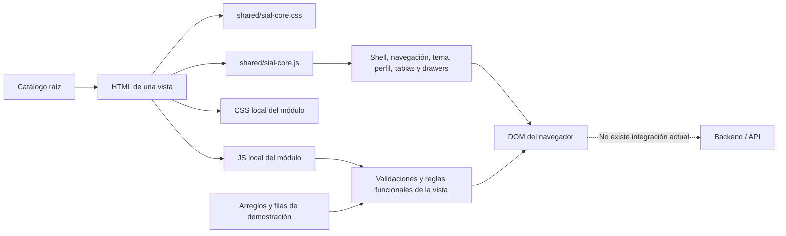

# SIAL Web - Contexto y lógica actual

Fecha de corte: 2026-07-19  
Audiencias: construcción de la librería UI y construcción del frontend SIAL.

## 1. Contexto actual

SIAL Web es una propuesta navegable que materializa decisiones de experiencia, patrones visuales y reglas funcionales mediante HTML/CSS/JS local. Su valor principal es mostrar **qué debe experimentar el usuario y qué reglas se han representado**. No demuestra todavía cómo autenticar, persistir, autorizar o integrar esas operaciones en producción.

La interpretación correcta es:

- los HTML son contratos visuales y de composición;
- `shared` es el embrión de la librería común;
- los scripts de módulo expresan lógica de interacción y reglas de propuesta;
- los arreglos JavaScript y filas HTML son datos de demostración;
- los mensajes de éxito, auditoría y cambios de estado son simulaciones locales;
- los README contienen reglas y contratos futuros, no servicios ya conectados.

## 2. Modelo de ejecución

Cada vista carga el core compartido y después su script local. El core se publica como `window.SIALCore`; los módulos publican globales como `SIAL`, `SIALMaterials` o inicializadores específicos. No hay imports ES, aislamiento por paquete ni tipado.

## 3. Estado y persistencia reales

| Estado | Dónde vive | Persistencia actual |
| --- | --- | --- |
| Tema claro/oscuro | `data-theme` en el documento | `localStorage`, llave `sial-theme`. |
| Sidebar expandido/colapsado | Atributos del documento | `localStorage`, llave `sial-sidebar-state`. |
| Submenú del módulo activo | DOM | `localStorage`, llave `sial-nav-views:<area>:<module>`. |
| Preferencia de notificaciones del perfil | Componente de perfil | `localStorage`, llave `sial-notifications`. |
| Filtros, paginación y drawers | DOM y closures JS | Se pierde al recargar. |
| Formularios y validaciones | DOM | Se pierde al recargar. |
| CRUD simulado | Arreglos JS o filas HTML | Se pierde al recargar. |
| Permisos por rol | Arreglo `permissionRoles` | Se pierde al recargar. |
| Programaciones de contenedores | Arreglo `containerSchedules` | Se pierde al recargar. |
| Changelog administrado | Arreglo local `releases` | Se pierde al recargar. |
| Auditoría visual | Texto/arreglo/DOM | Se pierde al recargar. |

No se observan llamadas a API, almacenamiento de datos de negocio, sesión real ni manejo de tokens de autenticación.

## 4. Lógica compartida existente

La API pública real de `window.SIALCore` es más amplia que la enumerada en el documento de gobierno:

| API | Comportamiento actual |
| --- | --- |
| `qs`, `qsa` | Helpers de selección DOM. |
| `escapeHtml`, `normalize` | Normalización y escape de contenido renderizado. |
| `getSharedAssetUrl`, `ensureFavicon` | Resolución de activos compartidos e isotipo/favicons. |
| `initThemeToggle` | Tema claro/oscuro y persistencia local. |
| `initPageTransitions` | Barra, salida, overlay diferido y entrada entre páginas internas. |
| `initSidebarToggle` | Colapsado desktop, overlay responsive, `Escape` y foco inicial. |
| `initNavigation` | Render del menú desde `navigationRegistry` y resolución de rutas físicas/funcionales. |
| `initShell` | Entrada estable que inicializa navegación y comportamientos globales. |
| `initProfileMenu` | Popover de perfil, overlay, fincas, tema, notificaciones y cierre de sesión simulado. |
| `setFieldState` | Estado visual y accesible de error/éxito en campos. |
| `initDatePickers` | DatePicker compartido, navegación y selección de fecha. |
| `initTableFilters` | Búsqueda, estado, contexto, filtros extra, conteo y paginación 10/30/50. |
| `initTableExport` | Exportación CSV de las filas filtradas; omite la columna Acciones. |
| `initDrawer` | Apertura/cierre del detalle lateral. |
| `initStateActionConfirm` | Confirmación de activar/inactivar, cambio del DOM y auditoría visual. |
| `initEmbeddedForm` | Apertura, edición, cancelación y reset del formulario corto. |
| `initReleaseChangelog` | Render y filtros de entradas de changelog. |

### Reglas globales representadas

- Tema oscuro basado en tokens, no en estilos por vista.
- Sidebar responsive con corte principal en 900 px y reglas adicionales en 1200, 1024, 820, 768 y 520 px.
- Respeto por `prefers-reduced-motion`.
- Navegación por módulo y vista con compatibilidad para carpetas físicas heredadas.
- Formularios cortos embebidos; formularios extensos en vista dedicada.
- Listados con búsqueda, filtros, paginación, empty state y exportación.
- Detalle en drawer lateral derecho.
- Activar/inactivar en vez de eliminación física.
- Auditoría visible como parte del patrón, aunque todavía sea simulada.
- Perfil global sin abandonar la vista actual.
- Transición de páginas reversible mediante el bloque `SIAL View Motion`.

## 5. Lógica actual por capacidad

### Catálogo

- Renderiza las 74 vistas desde un arreglo estático.
- Filtra por texto, módulo, familia y estado.
- Muestra conteo visible y empty state.
- No descubre archivos automáticamente: agregar un HTML no lo agrega al catálogo.

### Login y autenticación

- Carrusel institucional y variante cover flow con pausa, controles y reducción de movimiento.
- Toggle de contraseña.
- Validación accesible de campos obligatorios.
- Política de contraseña representada: mínimo 8 caracteres, letras, números y símbolos.
- Confirmación de contraseña.
- OTP numérico completo de seis dígitos, autoavance, pegado y reenvío con contador.
- Selección de empresa con búsqueda, empresa activa y feedback de opción bloqueada.
- Submit con loading y redirección después de un temporizador.
- No valida credenciales, no envía OTP, no cambia contraseña y no crea sesión real.

### Usuarios, roles y permisos

- Gestión de usuarios con filtros y detalle lateral.
- Registro y edición con asignación acumulativa empresa + roles.
- Exige al menos una relación empresa/rol en la propuesta.
- Matriz de permisos por rol y módulo con acciones de consulta, creación, edición y otras definidas localmente.
- Permite aplicar/quitar permisos por módulo, revisar cambios y simular guardado.
- El guardado actual modifica arreglos en memoria y agrega auditoría visual con `prototipo.ui`.
- La persistencia futura indicada es `roles`, `rol_permiso`, `empresa_rol` y la asociación del usuario por empresa; no existe en este repositorio.

### Empresas

- Gestión y registro de empresa.
- Asignación múltiple de tipos de empresa.
- Transfer de roles disponibles/incluidos por empresa.
- Creación/edición de roles y matriz de permisos en el mismo flujo de propuesta.
- Clientes/exportadores para el flujo de aviso de corte.
- Contactos con validaciones de identificación, nombre, cargo, empresa/finca, correo, teléfono y dependencia.
- Dependencias como maestra corta.
- Las operaciones muestran éxito local; no persisten transacciones.

### Fincas y referencias

- Fincas como maestra grande con registro dedicado.
- Grupos, sectores, clases, tipos de fruta y productos como maestras cortas.
- Conversión a mayúsculas, obligatoriedad y verificación de duplicados contra listas incluidas en el HTML.
- Validación de mínimos/máximos y coordenadas geográficas en formularios que lo declaran.
- Productos por finca valida la relación compuesta finca + producto contra un `Set` local.
- Referencias representa creación, copia y versionamiento, pero sin persistencia ni contrato ejecutable.

### Transporte

- Conductores, categorías de licencia y relación conductor-licencia.
- Vehículos, tipos, documentación, disponibilidad y analítica.
- Formularios grandes dedicados para conductor y vehículo; maestras cortas embebidas.
- Programación individual con vehículo, conductor, fecha futura, destino y observaciones.
- Cálculo ISO de semana operativa desde la fecha seleccionada.
- Edición restringe vehículo y fecha; reprogramación crea conceptualmente una nueva operación vinculada a una finalizada.
- Programación masiva permite agregar filas, validar disponibilidad y simular guardado.
- Reglas documentales y disponibilidad se muestran con datos locales; no consultan fuentes reales.

### Puerto

- Maestras de contenedor, tipo, etapa y puerto con mayúsculas, obligatoriedad y duplicidad local.
- Número de contenedor con formato de cuatro letras y siete dígitos.
- Capacidad de tipo de contenedor mayor a cero.
- Programación semanal de uno o varios contenedores.
- Calcula inicio de semana, número ISO y estado programado/vigente/finalizado.
- Solo ofrece contenedores activos, disponibles en proceso y sin programación no finalizada para la misma semana.
- La etapa se obtiene del catálogo activo y no se captura libremente.
- Al guardar agrega objetos a `containerSchedules`; todo se pierde al recargar.
- El README propone `container_schedule` y endpoints futuros, pero no hay conexión backend.

### Planeación y aviso de corte

- Semanas productivas de lunes a domingo.
- Generación representada de 52 semanas desde la semana 1.
- Mes calculado desde la fecha final.
- Validación conceptual de no repetición y no traslape.
- Secuencia oficial de cintas: BL, AZ, RO, CA, NE, NA, VE, AM.
- Aviso de corte con vista de listado y modo creación en la misma página mediante `#crear`.
- Requiere semana, día, finca, referencia, pallets, versión AC, línea, cajas por pallet, fruta/clase, grupo, zona y cliente.
- Pallets y racimos estimados deben ser mayores a cero.
- Actualiza un resumen en vivo y solo muestra feedback local.
- Los contratos GET/POST y varias maestras continúan marcados como pendientes.

### Materiales y suministros

- Un script renderiza dinámicamente diez vistas a partir de datasets locales.
- Cubre pedidos sugeridos/adicionales/estándar, stock, pallets, órdenes de transporte, proveedores, entregas/POD y reglas documentales.
- Tablas, filtros, exportación, drawers y formularios embebidos usan el core compartido.
- Generación de resumen, envío y notificaciones son mensajes simulados durante 3,2 segundos.
- Los formularios muestran confirmación sin construir ni enviar payload real.

### Seguridad / trazabilidad

- Consolida eventos web de programación/reprogramación y eventos móviles de recepción, inspección, cierre y entrega.
- Permite filtrar, seleccionar operación, recorrer eventos, inspeccionar evidencia y abrir detalle.
- Incluye timeline, puntos de control, comentarios, firmas, estado de sincronización, lightbox y navegación por teclado.
- La aprobación humana y las evidencias son datos de propuesta en el arreglo `auditEvents`.
- No hay carga de archivos, firma, sincronización ni servicio de auditoría real.

### Indicadores

- Mantiene estado local por módulo, período, escenario, umbral y métrica seleccionada.
- Calcula proyección, disponibilidad, riesgo, capacidad, calidad, alertas y rankings desde datos base locales.
- Renderiza KPIs y múltiples visualizaciones con HTML/SVG/CSS propio.
- El botón exportar solo muestra un toast con un resumen; no genera un archivo ni consulta datos reales.

### Changelog

- Consulta externa e interna desde arreglos separados.
- Filtros y copia de enlace mediante el core compartido.
- Administración permite crear, editar y remover entradas en memoria.
- Remover significa despublicar y conservar auditoría visual, no eliminar.
- No existe persistencia ni servicio de publicación.

### Errores

- Vistas completas para errores de sesión, permisos, ruta, servicio y disponibilidad.
- Estado embebido `error-state` para fallas parciales dentro de una vista.
- Son contratos de presentación; no existe un router o middleware que los active.

## 6. Qué funciona de verdad y qué está simulado

| Funciona en el navegador | Está simulado o pendiente |
| --- | --- |
| Navegación entre HTML. | Autenticación y sesión. |
| Tema y preferencias visuales. | Envío y validación de OTP. |
| Responsive y motion. | CRUD persistente. |
| Filtros y paginación local. | Roles y permisos efectivos. |
| Exportación CSV de tablas. | Auditoría transaccional. |
| Validaciones de formulario. | Notificaciones externas. |
| Cálculos de semana/estado. | Programación operativa persistente. |
| Drawers, overlays y feedback. | Carga/almacenamiento de evidencias. |
| Render de indicadores y gráficas. | Datos analíticos desde servicios. |
| Cambios en arreglos/DOM durante la sesión. | API, DTO, manejo de errores remotos y reconciliación. |

## 7. Implicaciones para quien construye la librería

### Lo que ya existe como referencia

- 96 tokens CSS únicos, con variantes claro/oscuro.
- Shell, navegación, perfil, motion y breakpoints representados.
- Inventario visual de componentes y estados.
- Contratos por atributos `data-*` para conectar comportamiento.
- API funcional del core compartido.
- Patrones repetidos en múltiples módulos que permiten identificar candidatos reales a componentes.

### Lo que todavía no es una librería consumible

- `sial-core.css` es un archivo monolítico de 6.454 líneas.
- `sial-core.js` es un global de 2.078 líneas, sin módulos, tipos, versionado ni paquete.
- No existen props, eventos, slots, estados y contratos de accesibilidad formalizados por componente.
- No existen pruebas unitarias, visuales o de interacción versionadas dentro de la propuesta.
- La documentación de gobierno no enumera toda la API pública actual.
- Persisten implementaciones locales duplicadas aunque el core ya ofrezca el comportamiento.

Duplicaciones detectadas en scripts de módulo:

| Función repetida | Módulos/scripts |
| --- | ---: |
| `applyShell` | 9 |
| `initTableFilters` / `filterRows` | 9 |
| `setFieldState` | 9 |
| `initDrawer` | 8 |
| `initEmbeddedForm` | 7 |
| `initThemeToggle` | 6 |
| `initCatalogForm` | 3 |
| `initGenericForm` | 3 |
| `initRelationForm` | 3 |

Parte de esta duplicación funciona como fallback o compatibilidad; otra parte proviene de copias históricas. Por ejemplo, `Gestion de Fincas/sial-fincas.js` aún contiene funciones con nombres de conductores y licencias.

También hay una excepción de tamaño importante: `Trazabilidad/sial-trazabilidad.css` tiene 2.425 líneas, mientras que la mayoría de capas locales son mínimas. Debe decidirse qué parte es visualización específica de auditoría y qué parte pertenece al sistema compartido.

## 8. Implicaciones para quien construye frontend

- Portar el comportamiento y la jerarquía, no copiar literalmente la topología física heredada.
- Sustituir arreglos y filas de ejemplo por servicios, modelos y estado real.
- Definir contratos API antes de convertir mensajes de éxito en operaciones reales.
- Conectar autenticación, empresa activa, permisos y logout a la fuente autoritativa del producto.
- Conservar el patrón activar/inactivar salvo que una regla de negocio aprobada indique otra cosa.
- Tratar auditoría, correlation, usuario y fecha como datos de backend, no generarlos solo en cliente.
- Mantener formularios cortos embebidos y formularios extensos dedicados como decisión de experiencia ya representada.
- Mantener filtros, empty/error/loading/sin permisos, responsive, foco y reducción de movimiento al portar componentes.
- Resolver explícitamente las rutas funcionales que hoy están en carpetas heredadas: Referencias, Empresa y Seguridad.
- No interpretar `implementada` como “lista para producción”; significa que la experiencia está demostrada.

## 9. Desajustes y deuda documental actuales

1. El baseline de estabilización es del 2026-05-18 y ya no representa los hashes actuales del core, catálogo de componentes ni login. El isotipo sí conserva el hash documentado.
2. El contrato de componentes enumera una parte de `SIALCore`, pero omite helpers y capacidades hoy exportadas como DatePicker, exportación, assets y `navigationRegistry`.
3. El catálogo declara 66 vistas `implementada` sin distinguir “prototipo funcional” de “integración productiva”.
4. El catálogo tiene 74 vistas, mientras el repositorio contiene 89 HTML; los formularios auxiliares y entradas de módulo no siguen una regla única de publicación.
5. Algunas responsabilidades compartidas continúan duplicadas en scripts locales.
6. No hay manifiesto de librería, versionado semántico, changelog técnico del paquete ni pruebas automatizadas dentro de la carpeta.

## 10. Orden recomendado de lectura

Para construir la librería:

1. `shared/componentes.html` — inventario visual.
2. `shared/sial-core.css` — tokens y contratos de clase actuales.
3. `shared/sial-core.js` — comportamientos y atributos `data-*`.
4. `docs/sial-governance/shared-component-contract.md` — intención de gobierno.
5. CSS/JS local de cada módulo — excepciones y duplicaciones por resolver.

Para construir frontend:

1. `sial-catalogo.js` — alcance publicado.
2. README del módulo — intención y reglas.
3. HTML de la vista — composición, estados y microcopy.
4. JS del módulo — validaciones y lógica ejecutable de propuesta.
5. `shared/sial-core.js` — comportamiento transversal.
6. Contratos backend futuros mencionados en README — pendientes de confirmación, no implementaciones existentes.

## 11. Verificación realizada sobre el estado actual

- Los 20 archivos JavaScript pasan `node --check`.
- No se detectaron llamadas `fetch`, XHR, Axios ni rutas API en los scripts.
- El árbol de trabajo estaba limpio antes de agregar este levantamiento.
- `output/playwright` contiene evidencia visual ignorada por Git, no una suite ejecutable incluida.

Este documento describe el comportamiento observado en la propuesta a la fecha de corte. Cuando README y código difieren, el código explica lo que hoy se ejecuta y el README explica la intención o el contrato futuro.
